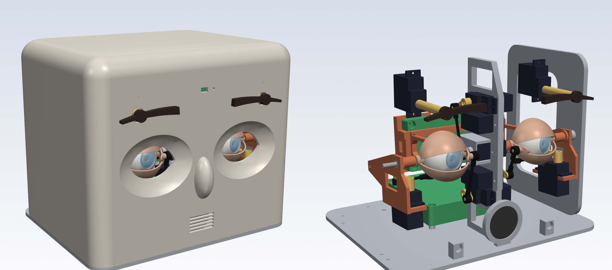
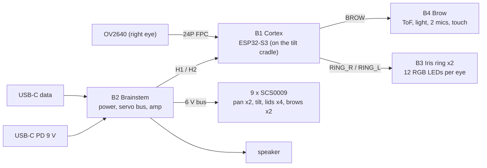
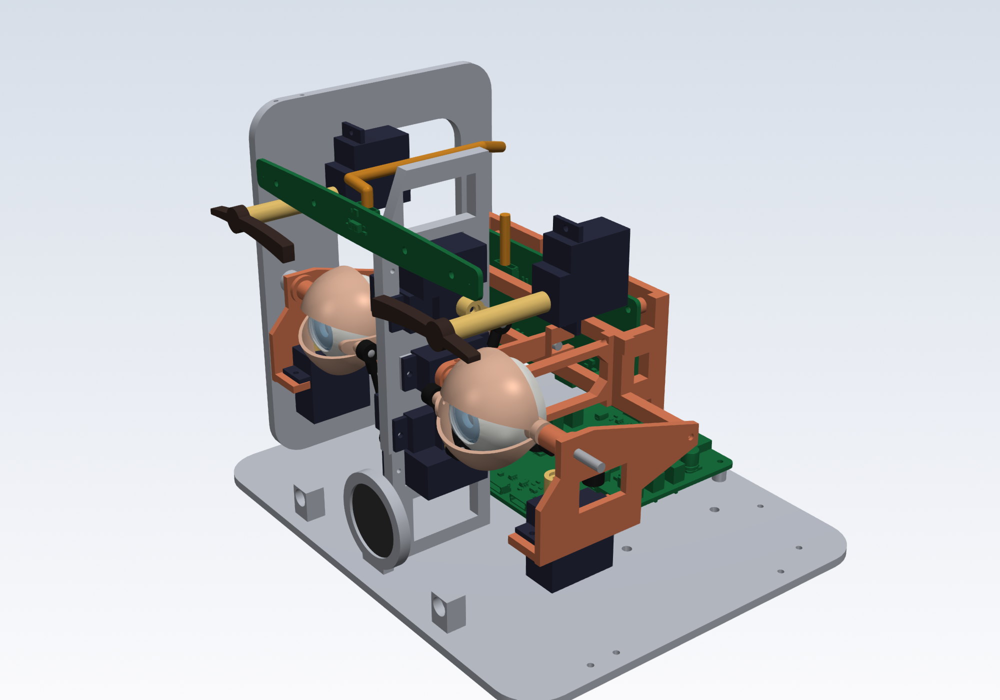
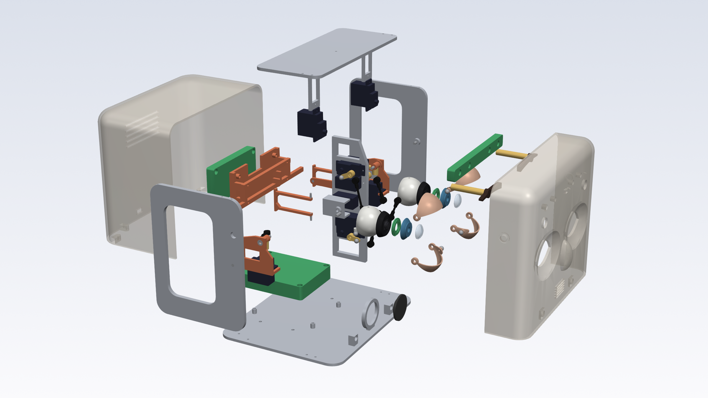
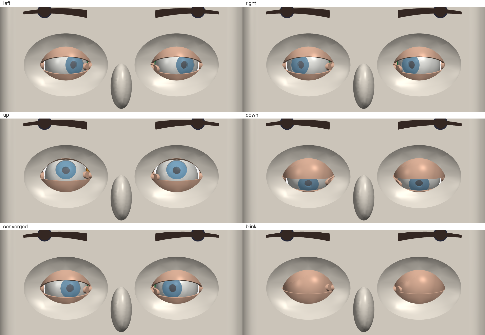
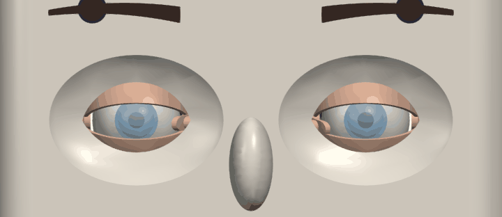

# Iris

An open-hardware robot head with human-scale eyes: a camera that looks out through a real pupil,
eyelids that blink and follow gaze, a glowing iris, and brows. Iris is built at 1.25 x human scale
around nine Feetech bus servos and four custom boards.

<p align="center"></p>

> **Status: not yet built.** This repository holds the complete mechanical design (parametric
> CadQuery source, STEP and STL for every printed part), the motion and board-fit checks, and the
> system documentation. The four boards are released in their own repositories (below) and fit the
> mechanism in CAD. No head has been printed, assembled or powered, and the firmware is not written.

This is the hub repository for the Iris project. Part of [HeyPCB's open robot boards](https://github.com/HeyPCB).

## What Iris is

Most robot eyes are either screens or a single pan-tilt camera. Iris tries to move like a human eye:

- **Real optics.** The right eye carries an OV2640 camera whose lens sits 2 mm behind a Dia 5.6 mm
  pupil, under a clear cornea. At 1.25 x scale that pupil reads as a normal 4.3 mm human pupil.
- **Human gaze geometry.** One cradle tilts both eyes together (as human eyes do), and each eye pans
  on its own, so Iris can converge on a near face. Pan is as fast as a human saccade (a 20 deg move in
  about 49 ms against 65 ms, est.); tilt, which moves the whole cradle, runs about 30 % slower (est.).
- **Eyelids that are lids.** Each eye has an upper and a lower lid, nested spherical visors that turn
  about the eye's horizontal axis. Their margins meet at the corners like a real fissure, they follow
  gaze, blink in under 100 ms and cannot touch each other or the cornea.
- **A living iris.** Twelve RGB LEDs on a ring board inside each eye light a translucent iris from
  behind.
- **Senses.** A forehead strip with a time-of-flight sensor (vergence distance), ambient light, two
  microphones 108 mm apart (sound direction) and a touch pad.
- **One cable to run it.** USB-C PD at 9 V (a 27 W charger or a PD power bank), with a second USB-C
  port for data.

## Features

- Parametric CadQuery source for every printed part (P1-P17), generated STEP and watertight STL
  ([`cad/`](cad/), [`cad/out/parts/`](cad/out/parts/)).
- 9 x Feetech SCS0009 on one 1 Mbps half-duplex bus with position feedback: pan x2, tilt, four lids,
  two brows.
- Inside-out pan forks and exact 1:1 parallelogram linkages: every joint angle equals its servo angle.
- Motion check over 80 540 pose evaluations: no collisions, at least 0.5 mm between moving parts and
  0.3 mm between static ones ([verification](docs/verification.md)).
- Board fit with the four released boards (KiCad STEP): every mounting hole on its boss axis (0.00-0.01
  mm), no interference over the full motion range, cable routes kept free.
- Headless renders and a gaze-and-blink animation, regenerated from the source.

## System



Details, power tree, the binding interconnect contracts and the as-built connector positions:
[docs/system.md](docs/system.md).

## Boards

| Board | Repository | Where | What |
|---|---|---|---|
| B1 Cortex | [HeyPCB/iris-cortex](https://github.com/HeyPCB/iris-cortex) | rear plate of the tilt cradle | ESP32-S3-WROOM-1-N16R8, camera FPC, LED-ring drivers, sensor and harness hub; 80 x 40 mm, 4 layers |
| B2 Brainstem | [HeyPCB/iris-brainstem](https://github.com/HeyPCB/iris-brainstem) | base plate | USB-C PD (CH224K, 9 V), 6 V / 5 A servo buck, 5 V logic buck, INA226, servo bus and 10 ports, MAX98357A; 64 x 80 mm, 4 layers |
| B3 Iris ring x2 | [HeyPCB/iris-ring](https://github.com/HeyPCB/iris-ring) | inside each eyeball | 12 x WS2812C-2020 behind the iris; Dia 18 / 7.6 mm annulus, 0.8 mm, 2 layers |
| B4 Brow | [HeyPCB/iris-brow](https://github.com/HeyPCB/iris-brow) | behind the forehead | VL53L1X, APDS-9306, 2 x ICS-43434, touch pad; 116 x 12 mm, 2 layers |

## Specifications

| | |
|---|---|
| Scale | 1.25 x adult human |
| Eyeballs | Dia 30.0 mm, 78 mm apart (centre to centre) |
| Camera | OV2640, 68.7 deg FOV, in the right eye; the left eye carries a matching dummy |
| Pan, each eye | +-35 deg, independent (version and vergence; 14.6 deg per eye converges on a face at 150 mm) |
| Tilt, both eyes | +25 deg up / -30 deg down |
| Upper lids | -40 ... +55 deg margin (rest +19), follow tilt 1:1 |
| Lower lids | -50 ... -6 deg margin (rest -20), follow tilt at half gain |
| Brows | +-20 deg roll each |
| Actuators | 9 x Feetech SCS0009 (0.10 s/60 deg at 6 V, 2.3 kg.cm, 0.293 deg feedback) |
| Speed (est.) | 20 deg saccade in about 49 ms (human 65 ms); blink closing about 78 ms (human 92 ms) |
| Sensors | ToF 4 m, ambient light, stereo I2S microphones, capacitive touch, servo position / load / temperature |
| Power | USB-C PD 9 V; about 6 W typical; >= 27 W charger or PD power bank |
| Size | 176 W x 148 H x 143 D mm (152 mm with the nose) |
| Printed parts | 36 parts from 27 files, 505 cm3 solid volume (636 g if printed solid) |

## Gallery

| | |
|---|---|
|  |  |
| Mechanism: tilt cradle, inside-out forks, nested lids, pushrods | Exploded view |

<p align="center"><br><em>Gaze poses (directions from the robot's point of view) and a blink</em></p>
<p align="center"></p>

All images are rendered headlessly from the CAD by `python -m cad.render`.

## Repository

| Path | Contents |
|---|---|
| [`cad/`](cad/) | parametric CadQuery source ([how to run](cad/README.md)) |
| [`cad/out/parts/`](cad/out/parts/) | STEP + STL of every printed part, in assembly position |
| [`cad/out/iris_assembly.step`](cad/out/iris_assembly.step) | rest-pose assembly with purchased-part and board envelopes |
| [`cad/out/envelopes/`](cad/out/envelopes/) | SCS0009 and OV2640 envelopes (from datasheet dimensions, not vendor CAD) |
| [`cad/out/parts.json`](cad/out/parts.json), [`check.json`](cad/out/check.json), [`fit.json`](cad/out/fit.json) | parts list, motion check, board fit |
| [`docs/system.md`](docs/system.md) | architecture, power tree, interconnect contracts |
| [`docs/mechanism.md`](docs/mechanism.md) | kinematics, ranges, linkage geometry, servo IDs, changes from the spec |
| [`docs/assembly.md`](docs/assembly.md) | print settings, bill of materials, step-by-step build |
| [`docs/firmware.md`](docs/firmware.md) | behaviour notes for the firmware (not written yet) |
| [`docs/verification.md`](docs/verification.md) | what was checked in CAD and what must be bench-tested |
| [`media/`](media/) | renders and the animation |

"Spec N" in these files names a section of the Iris system specification v0.1, the design-input
document the boards and this CAD were drawn from. The spec itself is not published: its binding
tables (interconnect contracts, board mounting) are copied in [`docs/system.md`](docs/system.md),
and [`docs/mechanism.md`](docs/mechanism.md) lists every place the build departs from it.

To regenerate everything:

```sh
pip install -r requirements.txt
python -m cad.build && python -m cad.check && python -m cad.fit && python -m cad.render
```

## Licence

Hardware, including the CadQuery source, the generated CAD files and the documentation:
[CERN-OHL-S-2.0](LICENSE) (CERN Open Hardware Licence Version 2, Strongly Reciprocal).

## Credits and inspiration

The Iris mechanism was drawn from scratch for this project. It takes only general ideas from earlier
open animatronic eyes, servo-driven lids hinged on the eye's horizontal axis and a camera inside the
eyeball, and none of their geometry:

- Will Cogley's eye mechanisms:
  [Snap-Fit Eye Mechanism](https://makerworld.com/en/models/486870-snap-fit-eye-mechanism) (CC BY-NC-SA 4.0),
  [Animatronic Eye Mechanism e3.2](https://makerworld.com/en/models/1184807-animatronic-eye-mechanism-e3-2)
  (MakerWorld Standard Digital File License), and the Instructables
  [Simplified 3D Printed Animatronic Dual Eye Mechanism](https://www.instructables.com/Simplified-3D-Printed-Animatronic-Dual-Eye-Mechani/)
  and [Animatronic Eye Mechanism](https://www.instructables.com/Animatronic-Eye-Mechanism/).
- The [InMoov eye mechanism](https://inmoov.fr/eye-mechanism/)
  ([Thingiverse 86387](https://www.thingiverse.com/thing:86387), CC BY-NC).

Iris differs where it matters: independent pan per eye (for vergence) instead of a coupled single
pan, inside-out forks instead of external yokes, a shared Helmholtz tilt cradle, and nested spherical
lids. Those designs are non-commercial; nothing from them is in this repository.

Human-eye reference values (sizes, ranges, saccade and blink timing) come from the published sources
cited in the Iris system specification v0.1.
