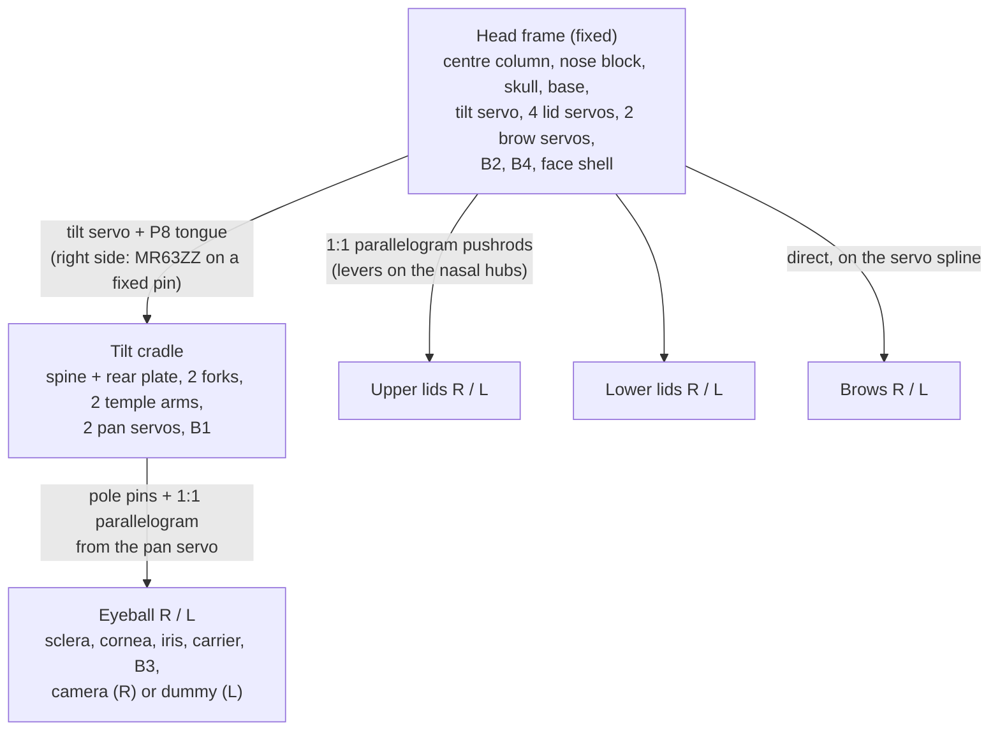

# Iris mechanism

Iris is built at 1.25 x human scale: 30.0 mm eyeballs on a 78 mm interpupillary distance. Nine
Feetech SCS0009 bus servos move it: one tilt for both eyes, one pan per eye, one servo per eyelid and
one per brow. Everything here is generated by the CadQuery source in [`cad/`](../cad/); every number
below comes from [`cad/params.py`](../cad/params.py) or the kinematics in
[`cad/kinematics.py`](../cad/kinematics.py), and the clearances from the motion check
([`cad/out/check.json`](../cad/out/check.json), summarised in [verification.md](verification.md)).

<p align="center"></p>

## Head frame and conventions

All CAD coordinates are in the head frame **H** (mm, degrees):

- origin midway between the two eye rotation centres;
- **+X forward** (out of the face), **+Y robot-left**, **+Z up**;
- right eye centre (0, -39, 0), left eye centre (0, +39, 0); the interocular axis is the Y axis.

| Quantity | Positive direction |
|---|---|
| tilt | look up (the cradle turns so that +X moves toward +Z) |
| pan | eye turns toward +Y (robot-left), about its own vertical axis |
| lid angle | elevation of the lid margin, atan2(z, x) about the Y axis through the eye centre |
| brow | inner (nasal) end up |

## Architecture: a Helmholtz cradle with inside-out forks



- **Tilt (shared elevation).** One cradle turns about the Y axis and carries both eyes, both pan
  servos and B1. Humans move both eyes vertically together, and Helmholtz coordinates put that shared
  vertical axis through both eyes. Vertical vergence is lost; humans hardly use it.
- **Pan (independent, inside-out).** Each eye turns on two Dia 2 mm pole pins held by a fork whose
  arms enter the eyeball through its open back. Nothing but the lids sits in front of the eye, so the
  lids can hug it.
- **Lids (nested visors).** Each lid is a spherical lune centred on the eye centre that turns about the
  Y axis through its own poles. The lid margins are therefore great circles that meet at the canthi,
  which gives the almond-shaped fissure. The upper lid (r 17.0-18.2) nests inside the lower lid
  (r 18.4-19.6), so the two lids of an eye can never touch: the upper lid tucks under the lower one at
  closure.
- **Brows.** One rotation each, about a forward axis at the brow's outer third.

## Servos and IDs

Port and ID map from the spec (binding for firmware); positions are the servo "output points" (1.0 mm
above the spline tip, on the shaft axis) in H.

| ID | Servo | B2 port | Output point (X, Y, Z) | Shaft | Body |
|---|---|---|---|---|---|
| 1 | pan R | J15 | (0, -65, -16) | +Z | below and behind, on the right temple arm |
| 2 | pan L | J10 | (0, +65, -16) | +Z | below and behind, on the left temple arm |
| 3 | tilt | J14 | (0, +15.95, 0) | +Y | nose bridge, coaxial with the Y axis, long side back |
| 4 | upper lid R | J16 | (-8, -15, +34.0) | -Y | centre column, long side forward |
| 5 | upper lid L | J11 | (-8, +15, +20.5) | +Y | centre column |
| 6 | lower lid R | J17 | (-8, -15, -34.0) | -Y | centre column |
| 7 | lower lid L | J12 | (-8, +15, -20.5) | +Y | centre column |
| 8 | brow R | J18 | (0, -54, +38) | +X | behind the forehead, long side up |
| 9 | brow L | J13 | (0, +54, +38) | +X | behind the forehead |

SCS0009: 0.10 s/60 deg at 6 V (600 deg/s no load), 2.3 kg.cm stall, 300 deg over 1024 counts
(0.293 deg/count), neutral 511 = 150 deg. The envelope in the CAD is drawn from the Feetech product
specification (2020-11-23) outline: case 23.3 x 12.1 x 25.25 mm, 3.2 mm spline (20T, OD 3.95), ears
32.5 mm overall with holes 28.5 mm apart at 16.8-18.4 mm above the case bottom.

## Ranges

| Axis | Mechanical range | Firmware envelope used by the motion check |
|---|---|---|
| tilt | +25 up / -30 down | full range |
| pan, each eye | +-35 | full range, independent (version and vergence) |
| upper lid margin | -40 ... +55 (rest +19) | rest + tilt + [-37, +36], clamped to the range |
| lower lid margin | -50 ... -6 (rest -20) | rest + 0.5 tilt + [-30, +14], clamped to the range |
| brow | +-20 | full range |

The lid envelope is the firmware's "lids follow gaze" rule (spec 2.5 / 8): the upper margin follows
tilt 1:1 and the lower one at half gain, with offsets for blinks and expressions. A blink at level gaze
is upper -18 / lower -12 (the upper margin tucks 6 deg under the lower one); looking down 30 deg it is
upper -40 / lower -27.

## Pan linkage: an exact 1:1 parallelogram

```
        top view, right eye (+X up the page)

             eye centre (0, -39)                 pan servo axis (0, -65)
                    o                                   o
                    |  eye crank (keel pin)             |  servo crank (P12)
                    |  14 mm, straight back             |  14 mm, straight back
                    o------------ coupler 26 mm --------o
                (-14, -39, -16)                     (-14, -65, -16)
```

- Eye crank: the M2 ball stud under the eye's keel, 14 mm straight back from the pan axis.
- Servo crank: an identical 14 mm arm (P12) on the pan servo; its stud points down into the same
  plane, Z = -16.
- Coupler: M2 rod with two ball links, 26 mm between ball centres, running along Y on the temporal
  side, below the camera FPC band.
- Because crank, crank, coupler and the axis-to-axis line form a parallelogram, **eye angle = servo
  angle exactly**. The transmission angle is 90 deg at rest and 55 deg at +-35 deg pan. The crank tip
  sweeps X -14.0 ... -11.5 and Y +-8.0.
- The keel band (Z -13.4 ... -10.1) passes 0.6 mm under the fork's lower arm and 0.6 mm over the ball
  link. Pan torque is under 0.01 kg.cm.

## Lid linkages: parallelograms with levers on the nasal hubs

Each lid has a 9 mm lever at its nasal hub and each lid servo a 9 mm horn (P17). A pushrod (M2 rod,
two ball links) joins them. Lever and horn stay parallel, and the coupler stays parallel to the line
from the lid axis to the servo axis, so **lid angle = servo angle + a constant offset**.

| Servo | Servo axis (X, Z) | Coupler (XZ) | Lever angle at mid-travel | Lever offset from the margin | Lever angles over the range | Worst transmission |
|---|---|---|---|---|---|---|
| upper L (ID 5) | (-8, +20.5) | 22.01 mm at 111.3 deg | 201.3 deg (points back) | +193.8 deg | 153.8 ... 248.8 | 42.5 deg |
| upper R (ID 4) | (-8, +34.0) | 34.93 mm at 103.2 deg | 193.2 deg (points back) | +185.7 deg | 145.7 ... 240.7 | 42.5 deg |
| lower L (ID 7) | (-8, -20.5) | 22.01 mm at -111.3 deg | -21.3 deg (points forward) | +6.7 deg | -43.3 ... 0.7 | 68.0 deg |
| lower R (ID 6) | (-8, -34.0) | 34.93 mm at -103.2 deg | -13.2 deg (points forward) | +14.8 deg | -35.2 ... 8.8 | 68.0 deg |

Lid geometry (all centred on the eye centre, turning about the Y axis):

| | Upper lid (P11) | Lower lid (P11) |
|---|---|---|
| shell | r 17.0-18.2, from the margin back 72 deg | r 18.4-19.6, from the margin down 30 deg |
| clearance to the eye | 0.6 mm to the corneal apex (r 16.4), 2.0 mm to the sclera | 3.4 mm to the sclera |
| hub caps (both canthi) | r 16.0-18.2, within 3.5 mm of the Y axis, Dia 3.2 bore | r 18.4-20.8, within 3.5 mm, Dia 3.2 bore |
| pins | nasal: right eye on a Dia 3 pin from the nose block, left eye on a Dia 3 pin in P8; temporal: Dia 3 stub pins from the temple arms (all free bushings) | same pins |
| lever | 9 mm tab at the nasal pole, M2 ball stud toward the nose, ball 21.3 mm from the eye centre | same |
| nesting gap upper / lower | 0.2 mm everywhere, shells and caps | |

Why the levers point in opposite directions: the two pushrods of one eye share one plane next to the
nasal hubs (ball centres at |Y| 17.7 at the lid, 18.5 at the horn; the ball links take the 0.8 mm
offset, about 2 deg). With both levers on the same side, they would meet at every blink. With the upper
lever pointing back and the lower one forward, they stay at least 68 deg apart over the whole lid
envelope.

The levers are tabs of the lids' own spherical shells at the nasal pole (starting 12 mm from the eye
centre toward the nose, clear of the keel of a fully panned eye), with an M2 ball stud pointing toward
the nose. The upper lever's stud crosses the lower lid's shell band only at angles where the lower lid
is never (at least 31 deg clear of its 30 deg wide shell sector).

## Tilt drive

- The tilt servo sits in the nose bridge, coaxial with the Y axis, spline face at Y +15.95.
- **P8 tilt drive tongue** clamps the spline with a split hub and an M2 cross screw (the axial horn
  screw is not used, so the axis is free for the left nasal lid pin). A 2.25 mm plate (Y 12.25-14.5)
  runs straight back to X -40, where a Dia 3 pin rides in a radial slot in the cradle's drive block.
  The pin-in-slot coupling is radially compliant, so the servo's own bearing and the right temple
  bearing never fight.
- **Right side**: a Dia 3 pin fixed in the right skull plate (Y -84 ... -71.6, spec support region
  -74 ... -80) in an MR63ZZ bearing pressed into the right temple arm. **Left side**: an optional
  loose bushing (Dia 3 pin in a Dia 3.2 bore) takes crash loads only.
- Cradle mass is about 110 g; gravity torque 0.20 kg.cm; peak torque at human saccade speed about
  0.69 kg.cm, 30 % of SCS0009 stall (spec estimates). If bench tests show sag, add a counterweight in
  the cradle's front lower bars.
- At full look-up the pan servos swing forward to X +24.6; the face plane (inner face X +26.5) is set
  by that and by B4.

## Eyeball

| Part | Geometry (eye frame: x along the optical axis) |
|---|---|
| P1 sclera | sphere R 15.0 / 13.4, open at the back over a 65 deg cone (shell spans 0-115 deg from the optical axis), limbus bore Dia 14.64, pole bosses Dia 5 at z +-(9.8 ... 14.2) with Dia 2.05 running bores, keel to the crank stud at (-14, 0, -16) |
| P2 cornea | clear dome R 9.75, 0.8 mm wall, apex x 16.40, base ring in the limbus bore from x 11.9 |
| P3 iris disc | Dia 14.5 x 0.8 (x 11.1-11.9), pupil Dia 5.6, black pupil sleeve back to x 9.1 over the lens step, cone ring that clamps B3 outside the LED band (inner r 8.0) and forms the white light-mixing cavity |
| P4 carrier | right: holder pocket 8.6 x 8.6 for the OV2640 (back x 4.36), FPC exit slot on the temporal side, ring-wire hole; left: same envelope with a printed dummy module. B3 seat Dia 18.2 with key flat (right eye flat down, left flat up) and a 0.7 mm pocket for B3's back-side parts |
| B3 | board B face at x 7.0, LEDs face the iris |
| Camera | lens front step at x 9.90, 2.0 mm behind the iris front; FPC leaves temporally and runs back along -X as a vertical sheet in the band \|z\| < 3 |

## Changes from the spec, and why

The binding positions (eye centres, IPD, tilt axis, pan pins, crank and coupler, servo outputs, lid
radii, 9 mm nasal levers, board planes and holes) are as specified. These non-binding details changed:

| Item | Spec v0.1 | Built | Why |
|---|---|---|---|
| Sclera rear opening | 60 deg half-angle | **65 deg** | at 60 deg the fork arm grazes the opening rim at +-35 deg pan (the concept measured 0.01 mm3 contact); 65 deg keeps the sclera to 115 deg, more than the 110 deg needed to stay visible at 35 deg pan |
| Lid hubs | flat bands, upper \|dy\| 18.2-19.4, lower 19.6-20.8 | **spherical polar caps** within 3.5 mm of the Y axis: upper r 16.0-18.2, lower r 18.4-20.8 | the hubs then nest with the same 0.2 mm gap as the shells, whatever the two lid angles |
| Lever direction | "9 mm lever on each nasal hub" | upper lever points **back**, lower lever **forward** (perpendicular to the coupler at mid-travel) | the two pushrods of one eye share one plane; same-direction levers collide at every blink (found while laying out the linkages) |
| Lid servo horns | 9 mm horn, Dia 18-20 disc in the concept | printed 9 mm arm whose plate sits at \|Y\| 15.0-16.3 | the upper-left horn sweeps over the upper-right servo case (which reaches \|Y\| 14.45); a horn at the spline would cut 1.2 mm into it. The concept model missed this because it did not check fixed parts against each other |
| Left nasal lid pin | coaxial with the tilt output | pressed into P8, which clamps the spline radially | an axial horn screw and a coaxial pin cannot share the axis |
| Upper-lid blink | rest +19 -> closed -12 | closes to **-18**, lower lid raised to -12 | at -12 the upper margin is still 8 deg above the resting lower margin and leaves a slit over the lower cornea |
| Face shell | "stylised hard shell, v1" | rounded box, flat face plane at X +29, almond openings 37 x 24 | B4 needs the shell's inner face >= 2 mm in front of its F face (here 4.5 mm); the pan servos swing to X +24.6 at full look-up |
| Pan crank | crank on the servo | arm above the coupler plane, stud pointing down | keeps the ball centres at Z -16 with 0.6 mm over the gear cover |

## Firmware-facing numbers

- Vergence per eye for a target at distance d: atan(39 / d). 150 mm: 14.57 deg; 250 mm: 8.87;
  400 mm: 5.57; 700 mm: 3.19; 1000 mm: 2.23; 2000 mm: 1.12.
- Servo angle = joint angle + calibration offset for every axis (all linkages are 1:1).
- Keep the lids inside the envelope above: with the upper lid fully open (+55) while looking down
  30 deg, the upper lid's shell reaches back onto the fork's top arm (13.6 mm3 overlap, listed in
  check.json under `mechanical_lid_range_outside_envelope`). Inside the envelope the upper margin is
  at most tilt + 55, which keeps it clear.
