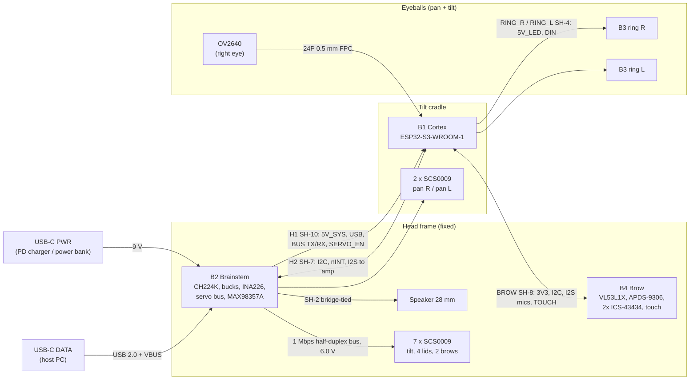
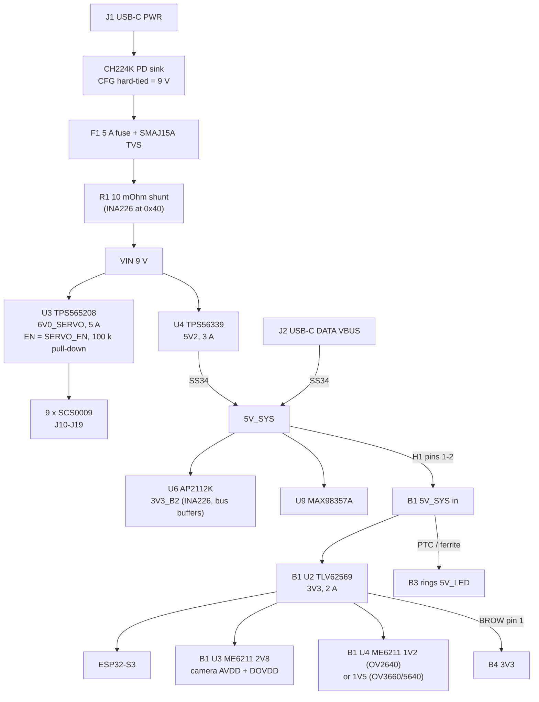

# Iris system architecture

This page is the system view: which board does what, how power flows, and the binding interconnect
contracts between the four board designs. It copies the contracts from the Iris system
specification v0.1 (section 5; the spec itself is not published) so the board repositories and
this hub agree. If a table here and a board repository disagree, this page wins until a spec
revision changes it.

## Boards

Iris has four board designs and five boards.

| Board | Repository | Lives on | Purpose | Outline | Layers |
|---|---|---|---|---|---|
| **B1 Cortex** | [HeyPCB/iris-cortex](https://github.com/HeyPCB/iris-cortex) | tilt cradle (moves with tilt) | ESP32-S3-WROOM-1-N16R8, OV2640 camera FPC, LED-ring drivers, sensor and harness hub, USB device | 80 x 40 mm | 4 |
| **B2 Brainstem** | [HeyPCB/iris-brainstem](https://github.com/HeyPCB/iris-brainstem) | base plate (fixed) | USB-C PD sink (CH224K, 9 V), USB-C data, 6.0 V / 5 A servo buck, 5 V / 3 A logic buck, INA226, half-duplex servo bus, 10 servo ports, MAX98357A amp | 64 x 80 mm | 4 |
| **B3 Iris ring** x2 | [HeyPCB/iris-ring](https://github.com/HeyPCB/iris-ring) | inside each eyeball | 12 x WS2812C-2020 behind the translucent iris | Dia 18.0 / 7.6 annulus, keyed flat | 2 (0.8 mm) |
| **B4 Brow** | [HeyPCB/iris-brow](https://github.com/HeyPCB/iris-brow) | behind the forehead (fixed) | VL53L1X ToF, APDS-9306 ambient light, 2 x ICS-43434 I2S mics 108 mm apart, touch pad | 116 x 12 mm | 2 |

Why this partition (spec 4):

- **B1 rides on the tilt cradle.** The camera FPC then only sees pan, a one-axis out-of-plane bend.
  The B1-B2 harness takes the tilt as a +-30 deg bend near the axis, which round wires handle well.
- **Power, PD and the servo bus are one board (B2).** Both are high-current and fixed; B2 also holds
  the bus driver, so only 3.3 V UART lines reach B1 and servo-side faults stay off the MCU board.
- **The iris is an LED ring (B3), not a round display.** A 1.28-inch round LCD is wider than the
  30 mm eye, a display in the pupil would block the camera, and a flat backlit iris looks less real
  than a physical iris under a cornea.
- **No eyelid or eye encoder board.** Bus servos report position. B4 adds what the eyes lack:
  distance for vergence, ambient light, stereo hearing for orienting saccades, and touch.

## Block diagram

## Power tree

USB-C PD at 9 V (spec 6). Typical draw is about 6 W; millisecond transients reach about 39 W (est.).
A 27 W (9 V 3 A) charger runs it tethered; a USB-C PD power bank is the battery option. There is no
Li-ion pack or charger on board.

| Rail | Source | Loads | Rest | Typical | Peak |
|---|---|---|---|---|---|
| VIN (9 V PD) | USB-C J1 -> F1 5 A -> R1 shunt | U3, U4 | 0.15 A (est.) | 0.68 A, 6.2 W | about 4.3 A for ms (39 W) (est.) |
| 6V0_SERVO | U3 TPS565208, 5 A | 9 x SCS0009 (idle 6 mA, running 150 mA, stall 1.0 A each) | 0.13 A | 0.58 A | burst 4.6 A (est.); all-stall 9 A must be cut by firmware |
| 5V_SYS | U4 TPS56339 3 A (+ DATA VBUS via D3) | B1 (via U2), rings, amp | 0.25 A | 0.41 A | 1.56 A |
| 3V3 (B1) | U2 TLV62569, 2 A | ESP32-S3, camera LDOs, B4 | 0.15 A | 0.25 A | 0.52 A |
| 2V8 / 1V2 (B1) | U3 / U4 ME6211 | OV2640 AVDD + DOVDD / DVDD | | | 50 / 50 mA |
| 3V3_B2 | U6 AP2112K | INA226, bus buffers | 5 mA | 5 mA | 10 mA |

Power modes:

- **J1 only (PD charger):** everything runs, no USB data (log over WiFi/BLE).
- **J2 only (PC port):** logic runs, servos stay off (VIN reads 0 V), rings dimmed, amp muted.
- Firmware enables SERVO_EN only when VIN >= 8.5 V and cuts it above a 3.3 A one-second average.

I2C map (whole system): INA226 0x40 (B2), VL53L1X 0x29 (B4), APDS-9306 0x52 (B4). No conflicts. The
camera SCCB is on its own pins.

## Interconnect contracts (binding, spec 5)

Conventions:

- "Pin n" = pad n of the KiCad footprint named, the pad the footprint marks as 1.
- All SH cables are **double-ended, same direction**: pin n to pin n, 28 AWG, pre-crimped.
- The rail **source** is the board that generates it.
- Cable lengths include a service loop over the full tilt sweep.

| Harness | From (source end) | To | Connector both ends | Length |
|---|---|---|---|---|
| H1 POWER/USB/BUS | B2 J5 | B1 J5 | JST SH 10 (SM10B-SRSS-TB, C160409) | 150 mm |
| H2 SENSE/AUDIO | B2 J6 | B1 J6 | JST SH 7 (SM07B, C160406) | 150 mm |
| BROW | B1 J4 | B4 J1 | JST SH 8 (SM08B, C160407) | 150 mm |
| RING_R / RING_L | B1 J2 / J3 | B3 P1-P4 (solder) | SH 4 (SM04B, C160404) at B1; 4 x 32 AWG silicone wires soldered to B3 | 100 mm |
| CAM | OV2640 module | B1 J1 | 24P 0.5 mm FPC (module's own) into AFC07-S24FCA-00 | module FPC >= 100 mm |
| SERVO x9 | B2 J10-J18 | servos | Molex 5264-3 (servo's own 150 mm lead); 100 mm 5264 extensions for brow and upper-lid servos | 150-250 mm |
| SPK | B2 J7 | speaker | JST SH 2 (SM02B, C160402) | 100 mm |
| USB | outside | B2 J1 / J2 | USB-C receptacle (TYPE-C-31-M-12) | - |

Every SH header pin count on one board is different: B1 has 4, 4, 8, 10, 7 (the two 4-pin ring
headers are interchangeable by design); B2 has 10, 7, 2. A cable cannot go into the wrong header,
except the two ring cables. Swapping those only swaps which RMT channel drives which eye, and the
firmware has a swap flag.

### H1: B2 J5 <-> B1 J5 (SH-10)

| Pin | Net | Dir | Level / type | Notes |
|---|---|---|---|---|
| 1 | 5V_SYS | B2 -> B1 | 4.85 V nominal (5V2 - SS34), <= 1.6 A total on pins 1-2 | source **B2** |
| 2 | 5V_SYS | B2 -> B1 | as pin 1 | |
| 3 | GND | - | | |
| 4 | GND | - | | |
| 5 | USB_DN | <-> | USB 2.0 FS D-, 90 Ohm pair with 6 | ESD on B2 (U5); B1 GPIO19 |
| 6 | USB_DP | <-> | USB 2.0 FS D+ | B1 GPIO20 |
| 7 | GND | - | | separates the USB pair from the UART |
| 8 | BUS_TX | B1 -> B2 | 3.3 V UART, 1 Mbps, 8N1, idle high | B1 GPIO42 -> U7 A + Q1 base network |
| 9 | BUS_RX | B2 -> B1 | 3.3 V UART | U8 Y -> B1 GPIO44; 10 k pull-up on B2 |
| 10 | SERVO_EN | B1 -> B2 | 3.3 V CMOS, active high | -> U3 EN via 1 k; **100 k pull-down on B2** |

### H2: B2 J6 <-> B1 J6 (SH-7)

| Pin | Net | Dir | Level / type | Notes |
|---|---|---|---|---|
| 1 | GND | - | | |
| 2 | I2C_SDA | <-> | 3.3 V open drain, 400 kHz | pull-ups 2.2 k **on B1 only** |
| 3 | I2C_SCL | B1 -> | 3.3 V open drain | |
| 4 | nINT | B2 -> B1 | open drain, active low | INA226 ALERT; 10 k pull-up on B1 (GPIO3) |
| 5 | I2S_BCLK | B1 -> B2 | 3.3 V, 3.072 MHz (48 kHz x 64) | 33 Ohm series at B1 |
| 6 | I2S_WS | B1 -> B2 | 3.3 V, 48 kHz | 33 Ohm series at B1 |
| 7 | I2S_AMP_SD | B1 -> B2 | 3.3 V I2S data | -> U9 DIN |

### BROW: B1 J4 <-> B4 J1 (SH-8)

| Pin | Net | Dir | Level / type | Notes |
|---|---|---|---|---|
| 1 | 3V3 | B1 -> B4 | 3.3 V, <= 50 mA | source **B1** (U2) |
| 2 | GND | - | | |
| 3 | I2C_SDA | <-> | 3.3 V OD | same bus as H2 (pull-ups on B1) |
| 4 | I2C_SCL | B1 -> | | |
| 5 | I2S_BCLK | B1 -> B4 | 3.3 V, 3.072 MHz | mic SCK (shared with H2 pin 5; separate 33 Ohm resistors at B1 per branch) |
| 6 | I2S_WS | B1 -> B4 | 3.3 V | mic WS |
| 7 | I2S_MIC_SD | B4 -> B1 | 3.3 V, tri-stated per slot by the mics | B1 GPIO40; 100 k pull-down on B1 |
| 8 | TOUCH | B4 -> B1 | analog capacitive | B1 GPIO14 (TOUCH14); keep away from pin 5 in the cable if possible |

### RING_x: B1 J2 (right) / J3 (left) <-> B3 pads (SH-4 to wires)

| Pin (B1) | B3 pad | Net | Dir | Level |
|---|---|---|---|---|
| 1 | P1 | 5V_LED | B1 -> B3 | 5V_SYS through a 0.5 A PTC or ferrite on B1; source **B2 via B1** |
| 2 | P2 | LED_DIN | B1 -> B3 | 5 V CMOS from U5/U6 (74AHCT1G125), 800 kHz WS2812 protocol |
| 3 | P3 | GND | - | |
| 4 | P4 | GND | - | |

### CAM: module <-> B1 J1 (24P FPC; pad n = module pin n)

| Pin | Signal | B1 net | Pin | Signal | B1 net |
|---|---|---|---|---|---|
| 1 | NC / STROBE | NC | 13 | XCLK | GPIO15 |
| 2 | AGND | GND | 14 | Y8 (D6) | GPIO17 |
| 3 | SIO_D | GPIO4 (4.7 k to DOVDD) | 15 | DGND | GND |
| 4 | AVDD | 2V8 (U3) | 16 | Y7 (D5) | GPIO18 |
| 5 | SIO_C | GPIO5 (4.7 k to DOVDD) | 17 | PCLK | GPIO13 |
| 6 | RESETB | 10 k to DOVDD + 100 nF | 18 | Y6 (D4) | GPIO12 |
| 7 | VSYNC | GPIO6 | 19 | Y2 (D0) | GPIO11 |
| 8 | PWDN | GPIO46 + 10 k to GND | 20 | Y5 (D3) | GPIO10 |
| 9 | HREF | GPIO7 | 21 | Y3 (D1) | GPIO9 |
| 10 | DVDD | 1V2 or 1V5 (U4) | 22 | Y4 (D2) | GPIO8 |
| 11 | DOVDD | 2V8 (U3) | 23 | Y1 | NC (AF_GND on OV5640-AF modules) |
| 12 | Y9 (D7) | GPIO16 | 24 | Y0 | NC (AF_VCC on OV5640-AF modules) |

These use module-side numbering; the AI-Thinker ESP32-CAM numbers the same signals in reverse, so map
by signal, not by number. Decoupling at J1: 4.7 uF + 100 nF on AVDD, DOVDD and DVDD. J1
(AFC07-S24FCA-00) is bottom contact: insert the fingers toward B1, and check pins 2 and 15 read 0 Ohm
to GND on the first board.

### SERVO ports: B2 J10-J19 (Molex 5267-03A footprint)

| Pad | Net | Notes |
|---|---|---|
| 1 | BUS_DATA | 3.3 V half-duplex, 1 Mbps; 10 k pull-up to 3V3_B2; servo accepts high 2-5 V |
| 2 | 6V0_SERVO | source **B2** (U3); <= 1 A per port (stall) |
| 3 | GND | |

Watch the numbering: the Feetech servo lead numbers its plug "1 GND, 2 Vcc, 3 Signal". Waveshare
boards number the mating header "1 DATA, 2 VCC, 3 GND". Same physical part, opposite numbering. Iris
follows Waveshare (pad 1 = DATA); the silkscreen prints D / V / G at each port.

### Port -> servo ID (binding for firmware)

| Port | J10 | J11 | J12 | J13 | J14 | J15 | J16 | J17 | J18 | J19 |
|---|---|---|---|---|---|---|---|---|---|---|
| Servo | ID 2 pan L | ID 5 upper lid L | ID 7 lower lid L | ID 9 brow L | ID 3 tilt | ID 1 pan R | ID 4 upper lid R | ID 6 lower lid R | ID 8 brow R | spare |

### SPK: B2 J7 (SH-2)

Pin 1 OUTP, pin 2 OUTN. This is a bridge-tied load: **neither wire is ground.** 4-8 Ohm, <= 1 W
speaker, 28 mm, in the chin holder on the base plate.

### USB-C

- **J1 PWR.** CC1/CC2 -> CH224K; VBUS -> D1 / F1; D+/D- -> CH224K DP/DM (BC1.2 only, not to the ESP).
- **J2 DATA.** CC1/CC2 -> 5.1 kOhm to GND each; D+/D- -> U5 -> H1; VBUS -> D3 -> 5V_SYS. It is never
  back-fed (D3).
- Both receptacle mouths are flush with B2's rear edge (X -110) and face the back of the head, through
  the two cut-outs in the back cover (P16b).

## Board mounting (binding, spec 4 and 7.3)

All board coordinates are in the head frame H (origin midway between the eye centres, +X forward,
+Y robot-left, +Z up).

| Board | Carried by | Hole positions in H (rest pose) | Boss tip | Clearance behind |
|---|---|---|---|---|
| B1 | P5 cradle rear plate | (-52, +-36, +-16), board plane X -52.0 / -53.6 | X -53.6 | 3.6 mm B-side parts |
| B2 | P16a base plate | (-34, +-28, -60), (-106, +-28, -60) | Z -61.6 | 2 mm B-side parts |
| B3 | P4 carrier + P3 clamp | (no holes) | B face x_eye +7.0 | - |
| B4 | P14 face shell | (+22, +-24, 50), (+22, +-46, 50) | X +22.0 (F face) | shell >= 2.0 mm in front of F |

The fit of each board against these mounts is checked by `cad/fit.py` with the released board STEP
files; results are in [verification.md](verification.md).

## As-built boards (released, KiCad 10.0.6 exports)

The four boards are final. These are the as-built facts the mechanism depends on, in the brief frame
(mm from the outline's top-left corner, x right, y down, seen from F) and in the head frame H.

| Board | Outline | Holes (brief) -> H | Faces | Heights (as built) |
|---|---|---|---|---|
| B1 Cortex | 80 x 40, 2 mm fillets | (4,4), (76,4), (4,36), (76,36) -> (Y, Z) (-36,+16), (+36,+16), (-36,-16), (+36,-16) | F X -52.0, B X -53.6; Y = x - 40, Z = 20 - y | F <= 3.1 mm in the STEP (<= 4.32 stated), B <= 3.2 (ESP32-S3 module on B, x 30.95-49.05, y 0.5-26.1, antenna at the top) |
| B2 Brainstem | 64 x 80, 3 mm fillets | (4,4), (60,4), (4,76), (60,76) -> (X, Y) (-34,+28), (-34,-28), (-106,+28), (-106,-28) | F up at Z -60.0; X = -30 - y, Y = 32 - x | F <= 7.8 mm (470 uF cans); all parts on F; THT tails below B |
| B3 Iris ring | Dia 18, key flat 8.4 from the centre, Dia 7.6 hole | none | B face x_eye +7.0; right eye +x -> +Y_eye, +y -> -Z_eye (pads temporal, flat down); left eye turned 180 deg | ordered **0.8 mm** (the fab STEP body is 1.51); LEDs to r 8.09, 0.84 tall; back parts 0.58 |
| B4 Brow | brow shape inside 116 x 12: 12.0 tall at the centre, 9.0 at the ends | NPTH (12,6), (34,6), (82,6), (104,6) -> Y -46, -24, +24, +46 at Z 50.0 | F X +22.0; Y = x - 58, Z = 56 - y | F <= 1.65 mm, B <= 3.05 (J1) |

Connectors and windows that the mechanism routes to:

| Board | Item | Brief position | In H | Opens toward |
|---|---|---|---|---|
| B1 | J1 camera FPC (AFC07, F) | x 0.3-5.8, y 11-29 | Y -39.7 ... -34.2, Z -9 ... +9 | -Y: FPC enters through the window in the cradle's right side wall |
| B1 | J2 RING_R (SH-4, F) | pin 1 (9.50, 34.65), mouth y 39.28 | Y -31 ... -26, Z -19.3 | -Z |
| B1 | J3 RING_L (SH-4, F) | pin 1 (74.60, 21.50), mouth x 79.22 | Y +39.2, Z -3 ... +3 | +Y: wires enter through the window in the cradle's left side wall |
| B1 | J4 BROW (SH-8, F) | pin 1 (20.50, 12.20), mouth y 7.58 | Y -28 ... -18, Z +12.4 | +Z: moved down from the spec's top-edge zone by the antenna keep-out; the cable runs up behind the top rail |
| B1 | J5 H1, J6 H2 (SH-10, SH-7, F) | bottom edge | Y -17 ... -5 and +5 ... +14, Z -19.3 | -Z |
| B2 | J1 USB-C PWR, J2 USB-C DATA | (17.0, 76.3), (47.0, 76.3) | X -106.3, Y +15 / -15 | -X, through the back cover's cut-outs |
| B2 | J5 H1, J6 H2, J7 SPK (SH, F) | y 3.4 | X -33.4, Y -6.5 / +8.5 / +19 | +X (front) |
| B2 | J10-J14 / J15-J19 servo headers (5267 vertical) | x 3.5 / 60.5, y 15-55 | Y +28.5 ... +23.5 / -28.5 ... -23.5 | up |
| B3 | wire pads P1-P4 (back) | r 7.6, 2.1 mm apart, temporal | - | wires go back through the arc slot in the carrier |
| B4 | VL53L1X window, 6 x 3.5 slot | centred (58, 6) | Y 0, Z 50.0 | face-shell slot |
| B4 | APDS-9306 window, Dia 2 | (58, 2.12) | Y 0, Z 53.9 | face-shell hole |
| B4 | mic ports, Dia 1.0 | (4, 6), (112, 6) | Y -54 / +54, Z 50.0 | face-shell holes |
| B4 | touch electrodes TP1, TP2 | x 39-49 and 67-77, y 1.25-6.25 | Y -19 ... -9 and +9 ... +19, Z 49.75-54.75 | solid pads in the face shell fill the gap in front of them |
| B4 | J1 BROW (SH-8, B) | centred (58, 3.35) | Y 0, Z 52.65, behind the board | +Z: the cable goes over B4's top edge |

Some parts have no 3D model in the board STEP exports; the fit adds them as envelopes from their
drawings: B1 J1 (AFC07 FPC connector), B2 J10-J19 (Molex 5267 vertical headers, est. 6.4 mm tall) and
J1/J2 (USB-C), B2's through-hole tails below the board (3.2 mm for the headers, 1.5 mm for the USB-C
shell legs), and B3's twelve LEDs.
